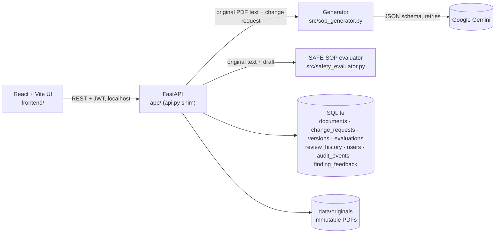

# SafeSOP AI

Generative AI for automated SOP and work-instruction revision. Upload an existing SOP PDF and describe a process change. SafeSOP AI drafts the revised SOP with Google Gemini, checks the draft automatically against the original, and keeps a full version and review history.

> Drafts are never safety-approved automatically. Only a qualified human reviewer can approve a version.

## How it works

1. **Upload.** The original PDF is stored unchanged (SHA-256 recorded) and is never overwritten.
2. **Generate.** The change request and the text of the original PDF (full document or one page) are sent to Gemini. Every generation, including a regeneration, uses the **original PDF** as its source. A regeneration records its parent version for lineage and passes the reviewers' comments on that parent to the model. Prompt v3 numbers the source's warnings (W1…) and steps (S1…), and the model returns JSON that cites those ids for every draft step and warning.
3. **Evaluate.** Each draft is checked automatically (evaluator `safe-sop-eval-1.2`) for missing or altered warnings, unsupported instructions or values, step-order violations, omitted, duplicated or conflicting steps, steps that do what a warning forbids, weakened quantifiers (all → most, before → after), a changed person on lock/tag/verify steps, and change requests that were not applied. Prompt-v3 drafts are matched to the source by id; older drafts by text. Findings quote their evidence with line numbers (and the PDF page where known), and "Show in comparison" jumps to the line. Reviewers can mark each finding "true problem" or "false alarm"; `evaluation/export_finding_feedback.py` turns those into labelled data. A draft with no findings shows "No rule fired", never "safe". See [research_logbook/EVALUATION_FRAMEWORK.md](research_logbook/EVALUATION_FRAMEWORK.md).
   - Optional **advisory semantic check** (`SEMANTIC_CHECK=nli|llm`, off by default): an NLI model or a Claude judge looks for draft steps that contradict a warning in different words. It can only add findings marked "advisory" and raise the status; it never lowers it. See `src/semantic_checker.py` and `TODO_HUMAN.md` before switching it on.
4. **Review.** A signed-in reviewer approves the version, rejects it, or marks it as needing revision. Approval is an electronic signature: the reviewer re-enters their password, and the decision records the evaluator version, the source PDF's SHA-256 and the approved text's SHA-256. Nobody can approve a version they generated. An **approved version is locked**: any later review is refused (HTTP 409); changes go into a new version.

### Users, roles and the audit log

Everyone signs in. Roles: **author** (upload, change requests, generate), **reviewer** (review decisions, finding verdicts), **admin** (everything, plus `POST /api/users`). The first admin is created from `ADMIN_USERNAME` / `ADMIN_PASSWORD` at startup; create other users through `/docs` (`POST /api/users`) while signed in as admin.

Uploads, generations, reviews and user creation are written to an append-only, hash-chained `audit_events` table in the same database transaction. `GET /api/audit/verify` recomputes the chain and names the first event that does not check out.

A change request can also be saved first and generated later: `POST /api/documents/{id}/requests` (with `target_page` for page scope), then `POST /api/documents/{id}/generate` with `request_id`. The draft is linked to that saved request.

### Limits

Checked before Gemini is called, so an oversized request never costs a model call:

| Input | Limit | Response |
|---|---|---|
| PDF upload | 20 MB | 413 |
| Pages, full-document scope | 50 (use page scope for longer PDFs) | 413 |
| Extracted source text | 60,000 characters | 413 |
| Change request | 2,000 characters | 422 |
| Review comments | 2,000 characters | 422 |

## Architecture



Every version stores where it came from: `source_document_id` (always the original upload), `parent_version_id` (the draft it revises, for lineage only), the model, the prompt version and the temperature.

## Setup (Windows)

```
python -m venv .venv
.venv\Scripts\activate
pip install -r requirements.txt
cd frontend
npm install
```

Create `.env` in the project root. Never commit it; it is already gitignored.

```
GEMINI_API_KEY=your-key-here
GEMINI_MODEL=gemini-3.5-flash-lite
# optional, default 0.2
GEMINI_TEMPERATURE=0.2
# optional, comma-separated origins allowed to call the API (default: the Vite dev server)
ALLOWED_ORIGINS=http://localhost:5173,http://127.0.0.1:5173
# optional advisory semantic check: off (default) | nli | llm  (see src/semantic_checker.py)
SEMANTIC_CHECK=off
# sign-in: a long random secret (without it, logins end when the API restarts)
JWT_SECRET=replace-with-a-long-random-string
# first admin, created once at startup if it does not exist
ADMIN_USERNAME=admin
ADMIN_PASSWORD=choose-a-strong-password
# optional: keep the database and stored PDFs somewhere else (default: data/)
# SAFESOP_DATA_DIR=D:\safesop-data
```

The frontend calls `http://127.0.0.1:8000` by default (the backend health check is retried every 15 s, so start order does not matter). To use another backend, set `VITE_API_BASE` in `frontend/.env.local`.

Check the connection with `python scripts/check_gemini.py` (one real, billed API call). It should print `SUCCESS: SafeSOP AI connected`. It is a manual script, not a test: `pytest.ini` limits pytest to `tests/`, so a bare `pytest` never calls Gemini.

## Run

Terminal 1, from the project root:
```
.venv\Scripts\activate
uvicorn api:app --reload --port 8000
```
Terminal 2:
```
cd frontend
npm run dev
```
Open http://localhost:5173 and sign in. Pages: `/documents`, `/documents/:id`, `/versions/:id`, `/versions/:id/review`, `/checks`. The API docs are at http://127.0.0.1:8000/docs.

On every start the API runs the Alembic migrations (`migrations/`). A database created before Alembic is first upgraded in place (after a backup to `data/backups/`) and then stamped. No data is deleted. To migrate by hand: `alembic upgrade head`.

### Run with Docker (Postgres, API, nginx)

```
copy .env.example .env      (fill in GEMINI_API_KEY, JWT_SECRET, ADMIN_PASSWORD, POSTGRES_PASSWORD)
docker compose up --build
```

Open http://localhost:8080. The API image includes Tesseract for scanned PDFs. `/healthz` is liveness and `/readyz` checks the database and storage. Logs are JSON lines (`LOG_FORMAT=json`).

### Features added in phase 3

- **Background generation:** `/generate` answers 202 with a job; the page shows live progress (server-sent events) and survives "Stop watching".
- **LLM fallback:** `LLM_FALLBACK_PROVIDER=ollama` (a local model) takes over when Gemini fails; every version records the provider and whether the fallback was used.
- **Prompt-injection hardening:** rules in the system instruction; the PDF text is fenced by random per-request markers and treated as data.
- **Limits:** `GENERATE_PER_MINUTE` (default 5) and `GENERATE_PER_DAY` (default 100) per user.
- **Required-element checklists:** choose an SOP type at upload (lockout/tagout; OSHA 1910.119(f) operating procedure); losing a required element fails the draft.
- **Hierarchy of controls:** replacing a guard, interlock or ventilation with training, signs or PPE is flagged.
- **Section and step scope:** revise one section or step; everything else stays word for word.
- **Translations:** Hindi and 9 other Indian languages, checked by independent back-translation.
- **OCR** for scanned pages (needs Tesseract).
- **Exports:** approved versions as DOCX/PDF with the approval record and change log; evaluation report as PDF.
- **Comparison:** version against version, and an original-PDF preview pane.
- **Dark mode** and self-hosted fonts.

## Test and evaluate

```
.venv\Scripts\python -m pytest -q                                           # 154 tests, Gemini stubbed
.venv\Scripts\pip install -r requirements-dev.txt                          # ruff, mypy, pip-audit, pytest-cov
.venv\Scripts\ruff check . ; .venv\Scripts\mypy ; .venv\Scripts\python -m pytest --cov
cd frontend ; npm run lint ; npm test ; npm run test:coverage
.venv\Scripts\python evaluation\validate_evaluator.py                      # EXP-001c (64 cases), no API key needed
.venv\Scripts\python evaluation\make_charts.py                             # figures in results\charts
.venv\Scripts\python evaluation\run_generation_experiment.py --repeats 3   # EXP-002, needs Gemini key
.venv\Scripts\python evaluation\agreement.py results\EXP-002_annotation.csv # after human labelling
.venv\Scripts\python evaluation\export_finding_feedback.py                 # reviewers' finding verdicts -> labelled CSV
```

**EXP-003 benchmark** (30–50 public SOPs, two models, two annotators): see [docs/BENCHMARK.md](docs/BENCHMARK.md).

```
.venv\Scripts\python evaluation\run_generation_experiment.py --experiment EXP-003 --sop-dir benchmark --models <model-a>,<model-b> --repeats 1
.venv\Scripts\python evaluation\agreement.py results\EXP-003_annotation.csv
```

GitHub Actions (`.github/workflows/ci.yml`) runs the tests, EXP-001 and the frontend build on every push.

## Project layout

| Path | Purpose |
|---|---|
| `app/` | FastAPI app: `main.py`, `config.py`, `db.py` (SQLAlchemy engine + adapter), `auth.py`, `audit.py`, `limits.py`, `routers/`, `services/` (generation, jobs, evaluation, pdf, sections, exports) |
| `migrations/` | Alembic schema migrations (`alembic upgrade head`) |
| `src/llm_client.py` | LLM provider interface (Gemini, Ollama) with recorded fallback |
| `src/translator.py` | Regional-language output and the back-translation check |
| `src/checklists/` | Required-element rule packs (YAML) per SOP type |
| `Dockerfile`, `docker-compose.yml`, `frontend/Dockerfile` | Containers: API, Postgres, nginx-served frontend |
| `api.py` | Compatibility shim so `uvicorn api:app` and `import api` keep working |
| `src/sop_generator.py` | Gemini prompt (`PROMPT_VERSION`) and generation |
| `src/safety_evaluator.py` | SAFE-SOP automated evaluator (`evaluate_revision`) |
| `src/semantic_checker.py` | Optional advisory semantic check (NLI or LLM judge), off by default |
| `docs/BENCHMARK.md` | How to collect, run, label and score the EXP-003 benchmark |
| `src/document_parser.py` | PDF helpers used only by the legacy prototype (the API extracts text in `app/services/pdf.py`) |
| `frontend/` | React + Vite interface: `src/App.jsx` (routes), `src/state.jsx` (auth, notices, backend status, data hooks), `src/pages/`, `src/components/`. See [frontend/README.md](frontend/README.md) |
| `scripts/check_gemini.py` | Manual Gemini connection check (billed call, not a test) |
| `TODO_HUMAN.md` | Open decisions that need a person (product, licence, cost, labelling) |
| `evaluation/` | Test set and experiment scripts |
| `results/` | Experiment summaries (raw model outputs in `results/raw/` are gitignored) |
| `research_logbook/` | Evaluation framework and research logbook |
| `legacy/` | Archived Streamlit prototype (not used) |

## Known limitations

- OCR needs Tesseract on the server (included in the Docker image). All outputs are text and do not reproduce the PDF layout.
- Sections are detected by shape (ALL-CAPS or "Title:" lines); SOPs styled differently show no sections and keep full/page scope.
- The evaluator compares words, not meaning. v1.1 added opposite words (on/off, open/close, …) and unit changes (rpm → rcf); v1.2 adds warning contradictions, quantifier, actor and change-applied checks, all from word lists. It still misses meaning changes outside those lists (3 of 24 held-out cases, e.g. "any" → "most"), flags some correct paraphrases for review, and has not been measured on real model errors yet. See the logbook, entries 2, 4 and 9.
- Sign-in has no password reset, account lockout or login rate limit yet, and users are managed through the API only. Keep it on a trusted network.
- Background jobs and the per-minute rate limit live in the API process: run one API process (scale up, not out) until they move to Redis or Postgres.
- Postgres support, the Docker images and OCR were not run on the development machine (see TODO_HUMAN.md).
- PyMuPDF is AGPL-licensed; see TODO_HUMAN.md before offering the app as a service.
