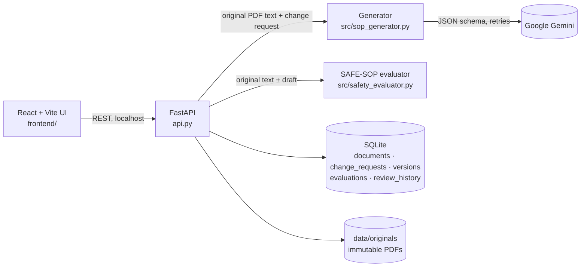

# SafeSOP AI

Generative AI for automated SOP and work-instruction revision. Upload an existing SOP PDF and describe a process change. SafeSOP AI drafts the revised SOP with Google Gemini, checks the draft automatically against the original, and keeps a full version and review history.

> Drafts are never safety-approved automatically. Only a qualified human reviewer can approve a version.

## How it works

1. **Upload.** The original PDF is stored unchanged (SHA-256 recorded) and is never overwritten.
2. **Generate.** The change request and the text of the original PDF (full document or one page) are sent to Gemini. Every generation, including a regeneration, uses the **original PDF** as its source. A regeneration only records its parent version for lineage.
3. **Evaluate.** Each draft is checked automatically for missing or altered warnings, unsupported instructions or values, step-order violations, and omitted, duplicated or conflicting steps. See [research_logbook/EVALUATION_FRAMEWORK.md](research_logbook/EVALUATION_FRAMEWORK.md).
4. **Review.** A reviewer approves the version, rejects it, or marks it as needing revision. Each decision is stored with a timestamp.

## Architecture



Every version stores where it came from: `source_document_id` (always the original upload), `parent_version_id` (the draft it revises, for lineage only), the model, the prompt version and the temperature.

## Setup (Windows)

```
python -m venv .venv
.venv\Scripts\activate
pip install -r requirements.txt
cd frontend
npm install
```

Create `.env` in the project root. Never commit it; it is already gitignored.

```
GEMINI_API_KEY=your-key-here
GEMINI_MODEL=gemini-3.5-flash-lite
# optional, default 0.2
GEMINI_TEMPERATURE=0.2
```

The frontend calls `http://127.0.0.1:8000` by default. To use another backend, set `VITE_API_BASE` in `frontend/.env.local`.

Check the connection with `python test_gemini.py`. It should print `SUCCESS: SafeSOP AI connected`.

## Run

Terminal 1, from the project root:
```
.venv\Scripts\activate
uvicorn api:app --reload --port 8000
```
Terminal 2:
```
cd frontend
npm run dev
```
Open http://localhost:5173. The API docs are at http://127.0.0.1:8000/docs.

On first start against an older database, the API backs up `data/safesop.db` to `data/backups/` and then adds the new columns and tables. No data is deleted.

## Test and evaluate

```
.venv\Scripts\python -m pytest -q tests                                     # 38 tests, Gemini stubbed
.venv\Scripts\python evaluation\validate_evaluator.py                      # EXP-001, no API key needed
.venv\Scripts\python evaluation\make_charts.py                             # figures in results\charts
.venv\Scripts\python evaluation\run_generation_experiment.py --repeats 3   # EXP-002, needs Gemini key
.venv\Scripts\python evaluation\agreement.py results\EXP-002_annotation.csv # after human labelling
```

GitHub Actions (`.github/workflows/ci.yml`) runs the tests, EXP-001 and the frontend build on every push.

## Project layout

| Path | Purpose |
|---|---|
| `api.py` | FastAPI app and the canonical SQLite schema (documents, change_requests, versions, evaluations, review_history) |
| `src/sop_generator.py` | Gemini prompt (`PROMPT_VERSION`) and generation |
| `src/safety_evaluator.py` | SAFE-SOP automated evaluator (`evaluate_revision`) |
| `src/document_parser.py` | PDF helpers used only by the legacy prototype (the API extracts text in `api.py`) |
| `frontend/` | React + Vite interface: `src/App.jsx` (state), `src/pages/`, `src/components/` |
| `evaluation/` | Test set and experiment scripts |
| `results/` | Experiment summaries (raw model outputs in `results/raw/` are gitignored) |
| `research_logbook/` | Evaluation framework and research logbook |
| `legacy/` | Archived Streamlit prototype (not used) |

## Known limitations

- Text-based PDFs only (no OCR). Page-scoped output is text and does not reproduce the PDF layout.
- Only full-document and single-page scopes are supported. Section and step scopes are not implemented.
- The evaluator compares words, not meaning. Since v1.1 it catches opposite words from a fixed list (on/off, open/close, …) and unit changes with the same number (rpm → rcf), but it misses other meaning changes, and it flags some correct paraphrases for review. See the logbook, entries 2 and 4.
- No user accounts: anyone who can reach the API can record a review. Run it on localhost only.
