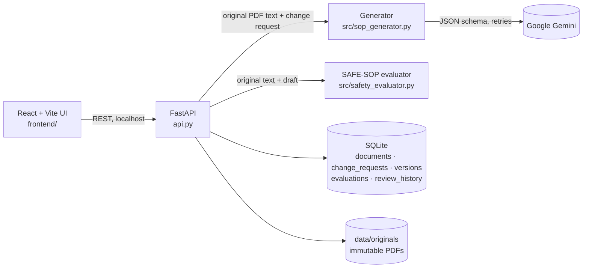

# SafeSOP AI

Generative AI for automated SOP and work-instruction revision. Upload an existing SOP PDF and describe a process change. SafeSOP AI drafts the revised SOP with Google Gemini, checks the draft automatically against the original, and keeps a full version and review history.

> Drafts are never safety-approved automatically. Only a qualified human reviewer can approve a version.

## How it works

1. **Upload.** The original PDF is stored unchanged (SHA-256 recorded) and is never overwritten.
2. **Generate.** The change request and the text of the original PDF (full document or one page) are sent to Gemini. Every generation, including a regeneration, uses the **original PDF** as its source. A regeneration only records its parent version for lineage.
3. **Evaluate.** Each draft is checked automatically (evaluator `safe-sop-eval-1.2`) for missing or altered warnings, unsupported instructions or values, step-order violations, omitted, duplicated or conflicting steps, steps that do what a warning forbids, weakened quantifiers (all → most, before → after), a changed person on lock/tag/verify steps, and change requests that were not applied. Findings quote their evidence with line numbers. A draft with no findings shows "No rule fired", never "safe". See [research_logbook/EVALUATION_FRAMEWORK.md](research_logbook/EVALUATION_FRAMEWORK.md).
   - Optional **advisory semantic check** (`SEMANTIC_CHECK=nli|llm`, off by default): an NLI model or a Claude judge looks for draft steps that contradict a warning in different words. It can only add findings marked "advisory" and raise the status; it never lowers it. See `src/semantic_checker.py` and `TODO_HUMAN.md` before switching it on.
4. **Review.** A reviewer approves the version, rejects it, or marks it as needing revision. Each decision is stored with a timestamp. An **approved version is locked**: any later review is refused (HTTP 409); changes go into a new version.

A change request can also be saved first and generated later: `POST /api/documents/{id}/requests` (with `target_page` for page scope), then `POST /api/documents/{id}/generate` with `request_id`. The draft is linked to that saved request.

### Limits

Checked before Gemini is called, so an oversized request never costs a model call:

| Input | Limit | Response |
|---|---|---|
| PDF upload | 20 MB | 413 |
| Pages, full-document scope | 50 (use page scope for longer PDFs) | 413 |
| Extracted source text | 60,000 characters | 413 |
| Change request | 2,000 characters | 422 |
| Review comments / reviewer name | 2,000 / 100 characters | 422 |

## Architecture



Every version stores where it came from: `source_document_id` (always the original upload), `parent_version_id` (the draft it revises, for lineage only), the model, the prompt version and the temperature.

## Setup (Windows)

```
python -m venv .venv
.venv\Scripts\activate
pip install -r requirements.txt
cd frontend
npm install
```

Create `.env` in the project root. Never commit it; it is already gitignored.

```
GEMINI_API_KEY=your-key-here
GEMINI_MODEL=gemini-3.5-flash-lite
# optional, default 0.2
GEMINI_TEMPERATURE=0.2
# optional, comma-separated origins allowed to call the API (default: the Vite dev server)
ALLOWED_ORIGINS=http://localhost:5173,http://127.0.0.1:5173
# optional advisory semantic check: off (default) | nli | llm  (see src/semantic_checker.py)
SEMANTIC_CHECK=off
```

The frontend calls `http://127.0.0.1:8000` by default (the backend health check is retried every 15 s, so start order does not matter). To use another backend, set `VITE_API_BASE` in `frontend/.env.local`.

Check the connection with `python scripts/check_gemini.py` (one real, billed API call). It should print `SUCCESS: SafeSOP AI connected`. It is a manual script, not a test: `pytest.ini` limits pytest to `tests/`, so a bare `pytest` never calls Gemini.

## Run

Terminal 1, from the project root:
```
.venv\Scripts\activate
uvicorn api:app --reload --port 8000
```
Terminal 2:
```
cd frontend
npm run dev
```
Open http://localhost:5173. The API docs are at http://127.0.0.1:8000/docs.

On first start against an older database, the API backs up `data/safesop.db` to `data/backups/` and then adds the new columns and tables. No data is deleted.

## Test and evaluate

```
.venv\Scripts\python -m pytest -q                                           # 74 tests, Gemini stubbed
.venv\Scripts\python evaluation\validate_evaluator.py                      # EXP-001c (64 cases), no API key needed
.venv\Scripts\python evaluation\make_charts.py                             # figures in results\charts
.venv\Scripts\python evaluation\run_generation_experiment.py --repeats 3   # EXP-002, needs Gemini key
.venv\Scripts\python evaluation\agreement.py results\EXP-002_annotation.csv # after human labelling
```

**EXP-003 benchmark** (30–50 public SOPs, two models, two annotators): see [docs/BENCHMARK.md](docs/BENCHMARK.md).

```
.venv\Scripts\python evaluation\run_generation_experiment.py --experiment EXP-003 --sop-dir benchmark --models <model-a>,<model-b> --repeats 1
.venv\Scripts\python evaluation\agreement.py results\EXP-003_annotation.csv
```

GitHub Actions (`.github/workflows/ci.yml`) runs the tests, EXP-001 and the frontend build on every push.

## Project layout

| Path | Purpose |
|---|---|
| `api.py` | FastAPI app and the canonical SQLite schema (documents, change_requests, versions, evaluations, review_history) |
| `src/sop_generator.py` | Gemini prompt (`PROMPT_VERSION`) and generation |
| `src/safety_evaluator.py` | SAFE-SOP automated evaluator (`evaluate_revision`) |
| `src/semantic_checker.py` | Optional advisory semantic check (NLI or LLM judge), off by default |
| `docs/BENCHMARK.md` | How to collect, run, label and score the EXP-003 benchmark |
| `src/document_parser.py` | PDF helpers used only by the legacy prototype (the API extracts text in `api.py`) |
| `frontend/` | React + Vite interface: `src/App.jsx` (state), `src/pages/`, `src/components/`. See [frontend/README.md](frontend/README.md) |
| `scripts/check_gemini.py` | Manual Gemini connection check (billed call, not a test) |
| `TODO_HUMAN.md` | Open decisions that need a person (product, licence, cost, labelling) |
| `evaluation/` | Test set and experiment scripts |
| `results/` | Experiment summaries (raw model outputs in `results/raw/` are gitignored) |
| `research_logbook/` | Evaluation framework and research logbook |
| `legacy/` | Archived Streamlit prototype (not used) |

## Known limitations

- Text-based PDFs only (no OCR). Page-scoped output is text and does not reproduce the PDF layout.
- Only full-document and single-page scopes are supported. Section and step scopes are not implemented.
- The evaluator compares words, not meaning. v1.1 added opposite words (on/off, open/close, …) and unit changes (rpm → rcf); v1.2 adds warning contradictions, quantifier, actor and change-applied checks, all from word lists. It still misses meaning changes outside those lists (3 of 24 held-out cases, e.g. "any" → "most"), flags some correct paraphrases for review, and has not been measured on real model errors yet. See the logbook, entries 2, 4 and 9.
- No user accounts: anyone who can reach the API can record a review. Run it on localhost only.
