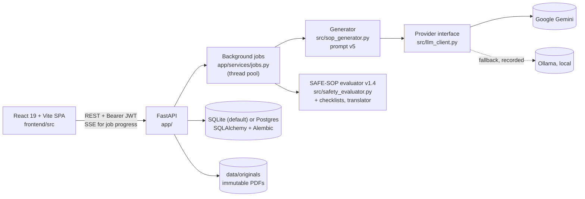
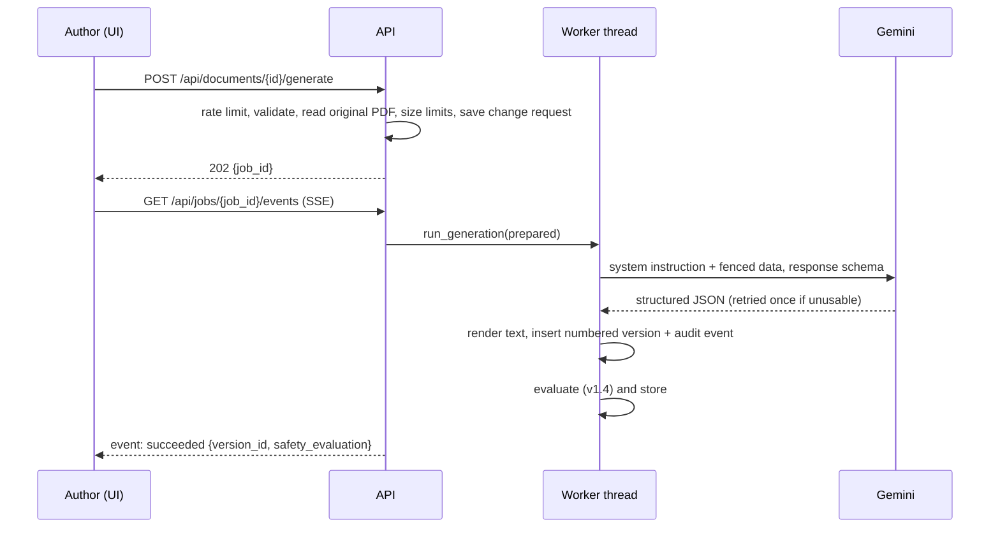
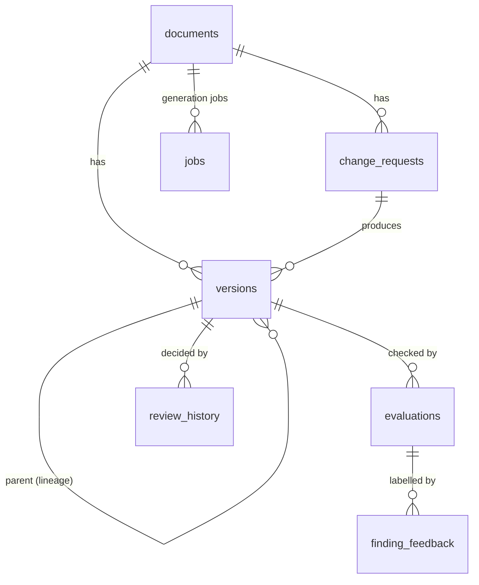

# SafeSOP AI — Architecture, database schema and API

Audience: developers and examiners who need to know how the system is put together. For setup and
running see the [README](../README.md); for the AI pipeline see [AI_PIPELINE.md](AI_PIPELINE.md); for
security see [SECURITY.md](SECURITY.md); for the evaluation method see
[EVALUATION_FRAMEWORK.md](../research_logbook/EVALUATION_FRAMEWORK.md).

## 1. Components

| Layer | Path | Responsibility |
|---|---|---|
| HTTP | `app/main.py`, `app/routers/*` | Routing, input validation, role checks, request logging |
| Services | `app/services/generation.py` | Fail-fast checks before the model call (`prepare_generation`), then model call, save and evaluation (`run_generation`) |
| | `app/services/jobs.py` | 202 + job id; worker threads; stages `queued → generating → saving → (translating) → evaluating → done` |
| | `app/services/evaluation.py` | Runs and stores evaluations; adds PDF page numbers to findings |
| | `app/services/pdf.py`, `sections.py`, `exports.py` | Text extraction (+ OCR), section/step outline and splicing, DOCX/PDF exports |
| Cross-cutting | `app/auth.py`, `app/audit.py`, `app/limits.py`, `app/db.py`, `app/storage.py` | Users, tokens, roles · hash-chained audit · rate limits and sign-in throttling · DB adapter and migrations · file paths |
| Domain | `src/` | Prompt and schema, provider interface, evaluator, checklists, translation, optional semantic check. No web code. |
| UI | `frontend/src/pages/*` | Dashboard, Documents, Document (revision studio + register), Version, Review, Checks, Users, Audit log, Account |

### Key invariants

1. **The original PDF is never written after upload**, and every generation reads it (never an earlier draft). `parent_version_id` is lineage only.
2. **Only `POST /api/versions/{id}/reviews` changes a version's status.** Generation always creates `draft`.
3. **Approved versions are locked** (HTTP 409 on any later review).
4. **Every state change that matters is audited in the same transaction** as the change (`append_audit` with the caller's connection, after `lock_writes()`).
5. **Automated checks never approve.** `pass_automated` means "no rule fired".

### Request flow: generating a revision

## 2. Database schema

Alembic revisions `0001_baseline` … `0007_ocr_pages` (`migrations/versions/`). The table list below was read
from a database migrated to head.

| Table | Columns | Notes |
|---|---|---|
| `documents` | id, filename, stored_path, sha256, size_bytes, created_at, page_count, document_type, ocr_pages | `stored_path` is relative to the data directory |
| `change_requests` | id, document_id → documents, description, scope (full/page/section/step), target_page, target_section, created_at | Saved before the model is called |
| `versions` | id, document_id → documents, request_id → change_requests, version_number, content, status, created_at, source_document_id → documents, parent_version_id → versions, target_page, target_section, model, prompt_version, provider, fallback_used, fallback_reason, temperature, input_tokens, output_tokens, structured_output, structured_json, created_by, output_language, translated_content, back_translation | UNIQUE(document_id, version_number); numbered under a write lock |
| `evaluations` | id, version_id → versions, status, metrics_json, findings_json, evaluator_version, created_at | Append-only; the latest is shown |
| `review_history` | id, version_id → versions, decision, reviewer, feedback, created_at, evaluator_version, evaluation_status, source_sha256, content_sha256 | What an approval signed |
| `finding_feedback` | id, evaluation_id → evaluations, finding_index, finding_type, verdict (true_problem/false_alarm), user, created_at | UNIQUE(evaluation_id, finding_index, user); annotation data |
| `users` | id, username (unique), password_hash (bcrypt), role, created_at | |
| `audit_events` | seq, id, ts, user, action, entity, entity_id, payload_json, prev_hash (unique), hash (unique) | Append-only (triggers on SQLite); hash chain |
| `jobs` | id, kind, document_id → documents, created_by, status, stage, http_status, detail, version_id, result_json, created_at, updated_at | Daily quota is counted from here |

Version statuses: `draft` → `needs_revision` | `rejected` | `approved` (locked). Evaluation statuses:
`fail` | `needs_review` | `pass_automated` (or `error` if the evaluator crashed; the draft is kept).

## 3. API reference

All `/api/*` endpoints except login, health and evaluator status need `Authorization: Bearer <token>`.
Interactive documentation with request and response schemas: `http://127.0.0.1:8000/docs`.
List endpoints take `limit` (1–500, default 100) and `offset` and return `total`.

| Method and path | Role | Purpose |
|---|---|---|
| `GET /healthz`, `GET /readyz` | public | Liveness; readiness (database + writable storage, 503 otherwise) |
| `GET /api/health`, `GET /api/evaluation/status` | public | UI connection check; evaluator version |
| `POST /api/auth/login` | public | `{username, password}` → token. 401 wrong; **429** after repeated failures |
| `GET /api/auth/me` | any | The signed-in user |
| `POST /api/auth/password` | any | `{current_password, new_password}`; ends other sessions; returns a new token |
| `GET /api/users`, `POST /api/users` | admin | List; create `{username, password, role}` |
| `PATCH /api/users/{id}` | admin | `{role}` and/or `{password}` (reset). 409 when demoting the last admin |
| `GET /api/overview` | any | Dashboard counts, review queue, recent decisions |
| `GET /api/documents` · `GET /api/documents/{id}` | any | Library; one document (page count, type, OCR pages) |
| `POST /api/documents/upload` | author | Multipart `file` (+ optional `document_type`). 400 not a PDF / empty / encrypted / no pages; 413 > 20 MB |
| `GET /api/documents/{id}/original` | any | The unchanged PDF |
| `GET /api/documents/{id}/outline` | any | Sections (SEC1…) and steps (S1…) for section/step scope |
| `GET /api/checklists` | any | SOP types with a required-element checklist |
| `POST/GET /api/documents/{id}/requests` | author / any | Save a change request without generating; list them |
| `POST /api/documents/{id}/generate` | author | Form: `description`, `scope`, `target_page` / `target_section`, `parent_version_id`, `request_id`, `output_language`. **202** with `job_id`; 4xx for input problems; 413 for size limits; 429 rate/quota |
| `GET /api/jobs/{id}` · `GET /api/jobs/{id}/events` | any | Job status; server-sent events `progress`, then `succeeded` or `failed` |
| `GET /api/documents/{id}/versions` · `GET /api/versions/{id}` · `.../content` | any | Register; metadata (incl. `structured_json`); full text |
| `GET /api/versions/{id}/diff?against=` | any | Line diff with the original text (default) or another version |
| `POST /api/versions/{id}/evaluate` | any | Re-run the checks (no model call) |
| `GET /api/versions/{id}/evaluations` | any | Evaluations with reviewers' finding verdicts |
| `PUT /api/evaluations/{id}/findings/{index}/feedback` | reviewer | `verdict=true_problem|false_alarm` |
| `POST /api/versions/{id}/reviews` | reviewer | `decision`, `feedback`, `password` (approval only). 403 wrong signature or own draft; 409 locked; 400 approving failed checks without justification; 429 after repeated wrong signatures |
| `GET /api/versions/{id}/reviews` | any | Review history |
| `GET /api/versions/{id}/download?format=txt|pdf&variant=draft|translation` | any | Draft, marked as an unapproved AI draft |
| `GET /api/versions/{id}/export?format=docx|pdf` | any | Approved controlled document with approval record and change log (409 unless approved) |
| `GET /api/versions/{id}/evaluation-report.pdf` | any | Latest automated evaluation as PDF |
| `GET /api/audit` · `GET /api/audit/verify` | admin · any | Audit events; recompute the hash chain |

## 4. Configuration

All settings are environment variables (or `.env`, never committed). The full list with defaults is in
`app/config.py`, `src/llm_client.py` and `.env.example`. Settings added in this phase:

| Variable | Default | Meaning |
|---|---|---|
| `LOGIN_MAX_FAILURES` | 5 | Failed sign-ins or approval signatures per username per window before 429 |
| `LOGIN_MAX_FAILURES_PER_CLIENT` | 20 | Same, per client address |
| `LOGIN_WINDOW_SECONDS` | 900 | The window |
| `LLM_OUTPUT_RETRIES` | 1 | Extra attempts when the model's output is truncated, blocked or empty |
