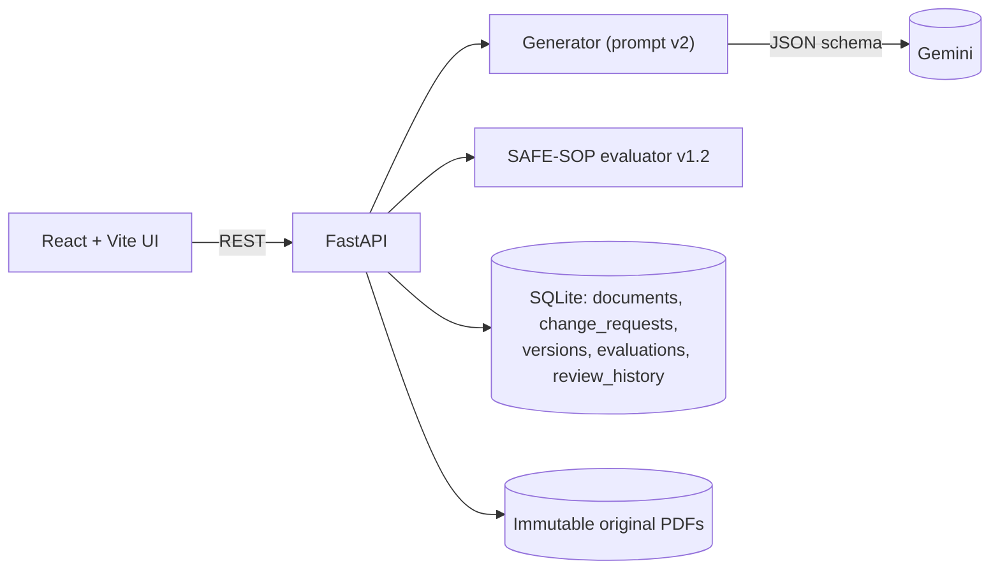
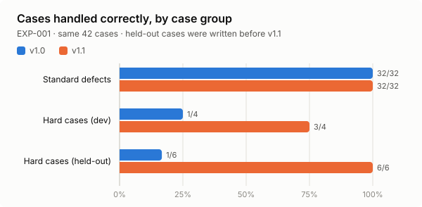
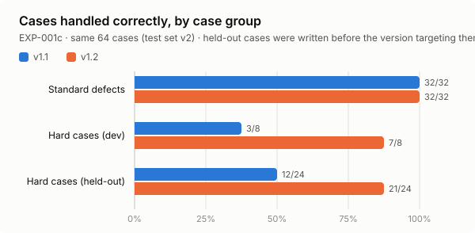

# SafeSOP AI: Generative AI for Automated SOP Revision with Safety-Critical Evaluation

**Tier 4 Capstone · Draft report**

Status: complete except the human-annotation rows of Section 5.3 (EXP-002), which are marked *pending*.

---

## Abstract

Standard Operating Procedures (SOPs) are updated by hand, so documentation lags behind process changes. SafeSOP AI drafts a revised SOP from an existing PDF and an engineer's change request using Google Gemini, then checks the draft automatically against the unchanged original for safety-critical failures. The checks are lost warnings, invented instructions or values, reordered steps, and omitted, duplicated or contradicted steps. Every draft is stored as a separate version with its lineage, model settings, automated evaluation and human review decision. We define an original rule-based evaluation framework (SAFE-SOP) with explicit metrics, thresholds and uncertainty rules, and validate it on 64 constructed cases. Version 1.2 adds checks for steps that contradict a warning, weakened quantifiers, changed actors and ignored change requests. It handles all 32 standard defects and 21 of 24 held-out hard cases (v1.1: 12 of 24), with one false alarm on the safe side. All cases are synthetic; accuracy on real model errors is not yet measured. The automated checks never approve a draft: approval is a recorded human decision.

## 1. Problem and objectives

**Problem.** SOP revisions are manual, slow and error-prone. An LLM can draft revisions quickly, but in safety-critical procedures a fluent draft that silently drops a warning, changes a value or reorders an isolation step is dangerous.

**Objectives.**
1. Draft revised SOPs from an existing PDF plus a process-change request.
2. Never modify the original. Always regenerate from the original, not from earlier drafts.
3. Detect, automatically and measurably, the failure types that matter for safety.
4. Keep a complete, auditable revision history, with human review separate from automated checks.

## 2. System design



- **Immutability.** Uploads are stored as `<uuid>.pdf` with their SHA-256 and are never written to again. An automated test confirms the hash is unchanged after several generations.
- **Regeneration rule.** Each generation reads the *original* PDF (the full document or one page). Regenerating from version *n* records `parent_version_id = n` for lineage only; version *n*'s text is never used as the source. This prevents errors compounding across revisions.
- **Generation.** The prompt (v2) treats the source as the authority, forbids invented facts, requires warnings and step order to be preserved, and asks the model to flag uncertainty. Output is a JSON object enforced by a response schema. Temperature is 0.2. The client retries rate-limit and server errors. Incomplete output is rejected, and no version is created.
- **Traceability.** Every version records its source document, parent, change request, scope or page, model, prompt version, temperature, token counts and time. Evaluations and reviews are append-only tables.
- **Human review.** A reviewer approves, rejects or requests revision. Approval needs a name, and if the automated checks did not pass, a written justification enforced by the server.

## 3. SAFE-SOP evaluation framework

The full definitions are in `research_logbook/EVALUATION_FRAMEWORK.md`. In summary:

| Check | Metric | Severity |
|---|---|---|
| Warning preservation | Warning recall = preserved / source warnings (token containment ≥ 0.8; 0.5–0.8 counts as *altered*) | missing = critical, altered = review |
| Unsupported instructions | Rate of draft steps not supported by the source and the change request (support < 0.5) | critical |
| Unsupported values | Numbers absent from the source and the change request; known numbers with a different unit | critical |
| Step-order integrity | Share of source step pairs kept in order (pairwise concordance) | any inversion = critical |
| Omitted, altered, duplicated, conflicting steps | Step mapping by Dice similarity; negation flips; opposite-word list | critical / review |
| Contradicted warnings (v1.2) | Any draft step, including new ones, that performs the verb + object (+ condition) a source warning forbids | critical |
| Weakened quantifiers (v1.2) | all / every / each / always / before replaced by some / most / a / after … in a matched line | critical |
| Changed actor (v1.2) | Different performer named on a lock, tag or verification line | high |
| Change not applied (v1.2) | Draft equals the original, or none of the request's new values or terms appear | critical |
| Uncertain cases | Borderline scores or undetectable structure | always `needs_review`, never a pass |

**Decision rule:** any critical or high finding → `fail`; else any review finding → `needs_review`; else `pass_automated` ("no rule fired", **not** approval). The model's own claims about which warnings it preserved are ignored.

## 4. Experimental setup

| ID | Data | Generator | Ground truth |
|---|---|---|---|
| EXP-001 / 001b | 4 synthetic SOPs written for this project (conveyor isolation, acid transfer, centrifuge, forklift inspection), each with 4 warnings and 8 steps, plus 1 legitimate change request each | None: drafts built by known edits | Exact (the edits are known) |
| EXP-001c | The same 4 SOPs; test set v2 adds 22 hard cases | None: drafts built by known edits | Exact |
| EXP-002 | The same 4 SOPs and change requests, 3 runs each | Gemini, prompt v2, temperature 0.2 | Two independent human annotators (framework §6) |

EXP-001 cases: for each SOP, 1 clean draft and 7 drafts with one injected defect each (missing warning, swapped steps, unsupported step, unsupported value, omitted step, duplicated step, negation flip). On top of these: 4 hard cases known while designing v1.1 (`hard-dev`), and 6 hard cases written before v1.1 existed (`hard-heldout`), including one negative control. 42 cases in total.

EXP-001c (test set v2) adds 22 hard cases: the four known v1.1 failures named before v1.2 was designed (an inserted "bypass the emergency stop" step, "all" → "most", a draft identical to the original, "each worker … personal lock" → "the supervisor … single lock"), which are `hard-dev`; and 18 `hard-heldout` cases written before any v1.2 code, covering contradicting inserted steps, quantifier weakening, actor and timing changes, ignored change requests, and 5 cases that should pass. 64 cases in total (11 should pass).

## 5. Results

### 5.1 EXP-001b: evaluator validation (v1.0 vs v1.1, same 42 cases)



| Group | v1.0 | v1.1 |
|---|---|---|
| Standard defects (32) | 32/32 | 32/32 |
| Hard, dev (4) | 1/4 | 3/4 |
| Hard, held-out (6) | 1/6 | 6/6 |
| Status accuracy (all 42) | 0.810 | 0.976 |
| Defect cases flagged | 0.806 | 1.000 |
| False alarms on defect-free cases | 0.167 | 0.167 |

Per finding type (v1.1), recall is 1.0 for every type: missing warning, omitted step, step-order violation, duplicated step, unsupported instruction, unsupported value and conflicting instruction. The only error is one false positive (`altered_warning` on a correct paraphrase). Full tables: `results/evaluator_validation_safe-sop-eval-1.1.md`.

### 5.1b EXP-001c: evaluator validation (v1.1 vs v1.2, same 64 cases)



| Group | v1.1 | v1.2 |
|---|---|---|
| Standard defects (32) | 32/32 | 32/32 |
| Hard, dev (8) | 3/8 | 7/8 |
| Hard, held-out (24, of which 6 should pass) | 12/24 | 21/24 |
| Status accuracy (all 64) | 0.734 | 0.938 |
| Defect cases flagged | 0.736 | 0.943 |
| False alarms on defect-free cases (11) | 0.091 | 0.091 |
| False alarms on held-out should-pass cases (6) | 0/6 | 0/6 |

Held-out recall of the new finding types (v1.2; 95% case-bootstrap intervals): `contradicts_warning` 4/5 = 0.8 [0.33, 1.0], `quantifier_weakened` 2/3 = 0.67 [0.0, 1.0], `change_not_applied` 2/3 = 0.67 [0.0, 1.0], `actor_changed` 1/1. No new finding type produced a false positive. With 1–5 cases per type the intervals are wide, and they are too narrow if anything, because cases built from the same SOP are not independent. Full tables: `results/evaluator_validation_safe-sop-eval-1.2.md` and, for the baseline, `results/evaluator_validation_safe-sop-eval-1.1_testset-v2.md`.

The three held-out misses show where the word lists end:

- "Raise the forks above the ground to inspect the chains" against "Do not inspect the forklift with the forks raised": the step's object (chains) is not the warning's object (forklift).
- "any inspection item" → "most inspection items": `any` is not in the strong-quantifier list.
- The requested "10 litres" was dropped, but "10" already occurs in the original ("within 10 metres"), so it is not a new value and the check has nothing left to look for.

### 5.2 What the misses taught us

v1.0 missed "switch off" → "switch on" and "3000 rpm" → "3000 rcf". Both are dangerous, and both keep almost every word, so overlap-based checks cannot see them. v1.1 adds an explicit opposite-word list and a number-plus-unit comparison. v1.1 in turn passed every case in which a draft step *added* something forbidden (it only compared draft steps with source steps), ignored "all", "each", "before" and "after" as stop-words, and could not tell when the change request had been ignored. v1.2 compares every draft step with every prohibition, keeps those words, and looks for the request's new values and terms in the draft. Each fix is again a word-level rule, with the blind spots listed in §5.1b.

### 5.3 EXP-002: real Gemini drafts

Model `gemini-3.5-flash-lite`, prompt v2 (JSON schema), temperature 0.2; 4 SOPs × 3 runs.

| Measure | Value |
|---|---|
| Successful generations | 12 / 12 (all structured output) |
| Status: fail / needs_review / pass_automated | 0 / 0 / 12 |
| Mean warning recall · step coverage · order integrity | 1.0 · 1.0 · 1.0 |
| Mean unsupported-instruction rate | 0.0 |
| Drafts that applied the requested change (manual check) | 12 / 12 |
| Cohen's κ between annotators | *pending human annotation* |
| Evaluator problem recall vs. humans | *pending human annotation* |
| Dangerous misses | *pending human annotation* |

On these short, well-structured SOPs, Gemini made no errors the framework detects, consistently across runs. This is a ceiling effect: it shows the pipeline works end to end with a real model, but not how well the evaluator catches real errors. The proposed EXP-003 uses harder inputs (longer public SOPs, multi-step or conflicting change requests) to provoke them. At the time of EXP-002 the evaluator did not check whether the requested change was applied, so this was checked by hand. v1.2's `change_not_applied` check now does this automatically, but only by looking for the request's new numbers and terms, and it has not been re-run on the EXP-002 drafts.

## 6. Discussion and limitations

- **The validation set is synthetic.** The standard-case scores show the rules work as designed; they are expected by construction. The held-out sets were written by the same team as the rules, who knew the target categories, so 21/24 shows generalisation within those categories, not to new kinds of error, and every case comes from the same 4 short SOPs.
- **Not yet measured:** precision and recall on *real* model errors (EXP-002 is waiting for two-person annotation and was a ceiling case; EXP-003 with 30–50 public SOPs and two models is scaffolded but not run); inter-annotator agreement (κ); false-alarm rate on long, real-world SOPs; and the advisory semantic checker (§7), which is implemented but switched off and unevaluated.
- **Words, not meaning.** Paraphrases can raise false alarms. Meaning changes that keep the same words, beyond the fixed opposite-word list, are missed.
- **Structure-dependent.** Steps must be numbered lines. Tables, multi-column layouts and scanned PDFs (no OCR) are not handled; they produce `needs_review`, not a pass.
- **Order approximation.** Every source step pair is treated as order-critical, which over-flags harmless reorderings.
- **Prototype security.** There are no user accounts; the system is intended for localhost use. Uploads are validated, SQL is parameterised, model output is escaped, and the API key is never logged.
- **No safety approval.** The framework cannot judge whether the requested change itself is safe.

## 7. Future work

1. Evaluate the advisory semantic checker (`src/semantic_checker.py`: an NLI model or an LLM judge from a different provider than the generator; off by default, it can only add findings) against the EXP-003 human labels. It is never used for approval.
2. Explicit dependency annotation (which steps must precede which), instead of treating all source order as critical.
3. OCR and table extraction. Section- and step-scoped revision.
4. Authenticated reviewers with roles.

## 8. Reproducibility

```
.venv\Scripts\python -m pytest -q tests
.venv\Scripts\python evaluation\validate_evaluator.py
.venv\Scripts\python evaluation\make_charts.py
.venv\Scripts\python evaluation\run_generation_experiment.py --repeats 3
.venv\Scripts\python evaluation\agreement.py results\EXP-002_annotation.csv
```

Dependency versions are pinned in `requirements.txt`. CI runs the tests and EXP-001 on every push. The research logbook (`research_logbook/LOGBOOK.md`) records every experiment, with dates and settings.
